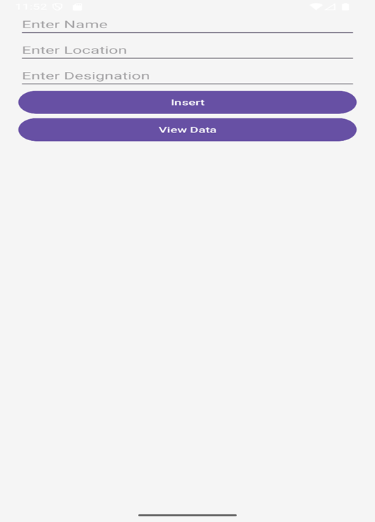

# 📱 SQLite Database Android App

A simple Android application that demonstrates how to use **SQLite Database** for storing and retrieving user information such as Name, Location, and Designation.

---

## 🚀 Features

- Insert user data into SQLite database
- View all stored records
- Basic input validation
- Simple and clean UI
- Uses `SQLiteOpenHelper` for database management

---

## 🛠️ Tech Stack

- **Language:** Java
- **IDE:** Android Studio
- **Database:** SQLite
- **UI:** XML Layouts

---

## 📂 Project Structure

com.example.sqlitedatabase

├── MainActivity.java # Insert user data
├── Detail.java # Display stored data
├── Database.java # SQLite helper class

├── res/
│ ├── layout/
│ │ ├── activity_main.xml
│ │ └── detail.xml
│ ├── values/
│ │ └── strings.xml

└── AndroidManifest.xml

## 📋 How It Works

### 1. Insert Data
- Enter Name, Location, and Designation
- Click **Insert** button
- Data is stored in SQLite database

### 2. View Data
- Click **View Data**
- Opens a new screen
- Displays all saved records in a ListView

---

## 🧾 Database Details

- **Database Name:** `users.db`
- **Table Name:** `user_table`

### Columns:

| Column Name | Type |
|-------------|------|
| ID | INTEGER (Primary Key, Auto Increment) |
| NAME | TEXT |
| LOCATION | TEXT |
| DESIGNATION | TEXT |

---

## ▶️ How to Run

1. Open the project in **Android Studio**
2. Wait for Gradle sync to finish
3. Click **Run ▶️**
4. Choose emulator or real device

---

## ⚠️ Limitations

- No update or delete feature
- Uses ListView instead of RecyclerView
- Basic UI design
- No advanced validation

---

## 🔮 Future Improvements

- Add Update & Delete functionality
- Replace ListView with RecyclerView
- Use Room Database instead of SQLite
- Improve UI with Material Design
- Add search/filter option

---

## 🤝 Contribution

Pull requests are welcome.  
Feel free to improve this project and add new features.

---

## 📄 License

This project is created for **educational purposes only**.

---

## 👨‍💻 ScreenShort

